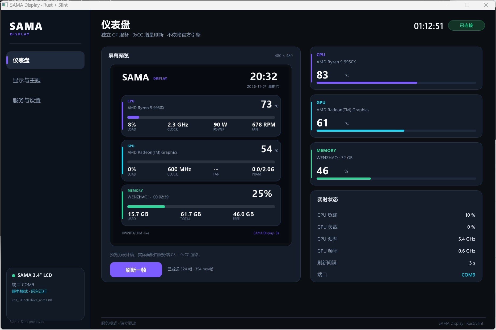
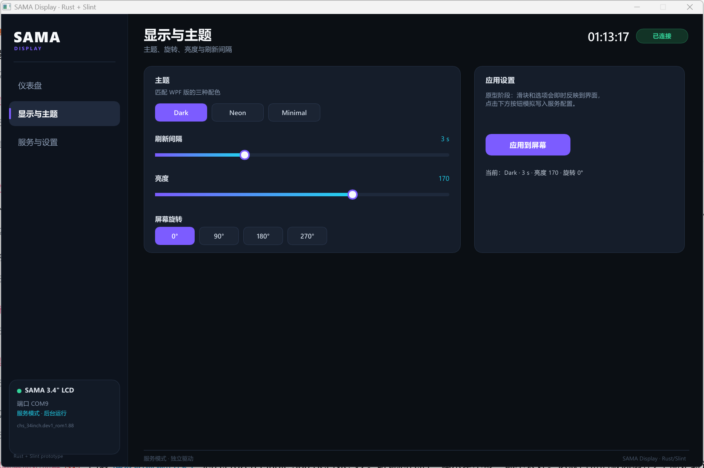
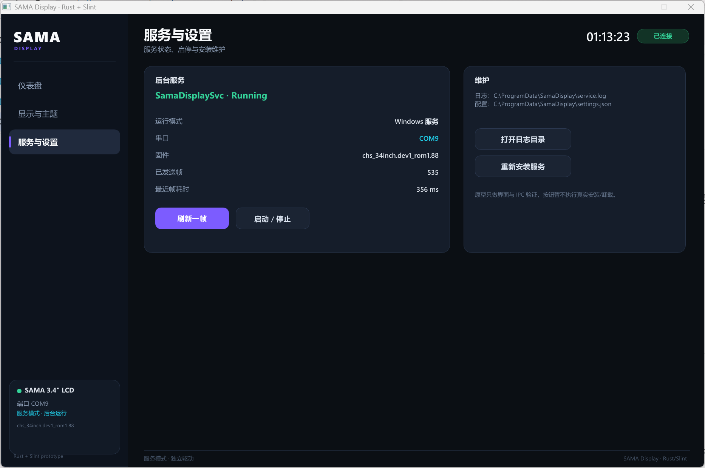

# SAMA Display · Rust + Slint 控制面板原型

这是现有 C# 服务的前端替代原型：**Rust + Slint**，通过命名管道 `SamaDisplay.IPC` 读取实时状态并下发设置。







## 已实现

- 三页原生桌面 UI：仪表盘 / 显示与主题 / 服务与设置
- 480×480 屏幕预览、CPU/GPU/内存卡片、实时状态
- 通过 `SamaDisplay.IPC` 读取：连接状态、端口、固件、帧数、帧耗时、温度、负载、频率、内存、刷新间隔、主题、亮度
- 按钮下发：`start`（刷新关键帧）、`theme`、`brightness`、`interval`、`rotate`
- 软件渲染（`renderer-software`），不依赖 OpenGL/C++ 运行时
- GUI 子系统（`#![windows_subsystem = "windows"]`），双击 exe 不会再弹控制台黑框
- 界面 1240×800，深色卡片 + 紫/青强调色，与 WPF 版保持一致

## 构建

本机使用 **Rust GNU 工具链 + WinLibs MSVCRT GCC**（不需要 Visual Studio）：

```powershell
# 一次性环境（示例路径以本机为准）
$env:CARGO_HOME = 'E:\AIWorkSpace\.cargo'
$env:RUSTUP_HOME = 'E:\AIWorkSpace\.rustup'
$mingw = 'C:\Users\<user>\AppData\Local\Microsoft\WinGet\Packages\BrechtSanders.WinLibs.POSIX.MSVCRT_*\mingw64\bin'
$tc = 'E:\AIWorkSpace\.rustup\toolchains\stable-x86_64-pc-windows-gnu'
$env:PATH = "$mingw;$tc\bin;$env:CARGO_HOME\bin;" + $env:PATH
$env:CC = 'x86_64-w64-mingw32-gcc'

cargo run
```

或使用 `.\build.ps1`（会自动查找 WinLibs / rustup 路径）。

## 服务自动拉起

- 应用启动时先探测 `SamaDisplay.IPC`；无响应则通过 Win32 SCM API（`OpenSCManagerW → OpenServiceW → StartServiceW`）直接启动服务，不创建 `sc.exe` 子进程，最多等待 12 秒。
- 安装器会通过 SDDL 给普通用户授予该服务的启动/停止/查询权限，因此不需要每次弹 UAC。
- 若服务未安装或启动失败，界面显示“服务未启动/未连接”，并保留 mock 数据。

## 原型限制

- 未做托盘、单实例、开机自启、安装器
- 服务启停按钮目前只打印日志，未真正调用 `sc.exe`
- 主题切换只改 C# 服务的主题配置，预览图仍为静态设计稿
- 尚未接入 PawnIO/传感器读取（数据来自 C# 服务，不在 Rust 侧重读）

## 目录

- `ui/app.slint`：全部界面与组件
- `src/main.rs`：窗口、定时器、IPC 轮询、按钮回调
- `src/ipc.rs`：命名管道 JSON 客户端（`\\.\pipe\SamaDisplay.IPC`）
- `assets/dashboard-preview.png`：预览图
