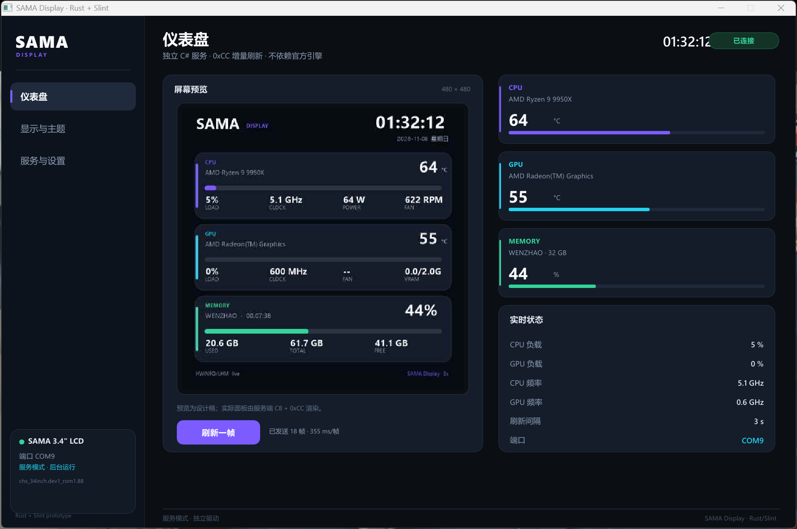

# SAMA Display · Rust + Slint 控制面板

现有 C# 服务的 Rust 前端替代实现，通过命名管道 `SamaDisplay.IPC` 读取实时状态、下发设置。




## 已实现

- 三页原生桌面 UI：仪表盘 / 显示与主题 / 服务与设置
- **实时预览**：C# 服务 `preview` IPC 返回当前 480×480 JPEG，每 2 秒刷新
- 实时状态：CPU/GPU 温度、负载、频率、内存、帧数、帧耗时、端口
- 设置：主题、亮度、刷新间隔、旋转，写入 C# 服务
- **系统托盘**：显示主界面 / 隐藏窗口 / 退出
- **关闭到托盘**：点 X 不再退出，窗口隐藏，托盘可恢复
- **单实例**：重复启动直接退出
- **服务自动拉起**：启动探测 IPC，无响应直接调用 Win32 SCM API
- **服务启停/重启**：`OpenSCManagerW / StartServiceW / ControlService`
- **安装/修复/卸载服务**：UI 按钮通过 UAC 调用安装脚本
- **开机启动开关**：写 HKCU Run 键
- 打开日志目录
- GUI 子系统：双击 exe 不弹控制台

## 安装

发布包内右键 `install-rust.ps1` → 以管理员身份运行。脚本会安装服务、PawnIO、Rust 前端，并创建开始菜单/桌面快捷方式。

## 构建

需要 Rust GNU 工具链 + WinLibs MSVCRT GCC：

```powershell
$env:CARGO_HOME = 'E:\AIWorkSpace\.cargo'
$env:RUSTUP_HOME = 'E:\AIWorkSpace\.rustup'
$env:PATH = '<WinLibs>\mingw64\bin;<toolchain>\bin;' + $env:CARGO_HOME + '\bin;' + $env:PATH
$env:CC = 'x86_64-w64-mingw32-gcc'
cargo build --release
```

或运行 `.\build.ps1` 自动查找路径。

## 目录

- `ui/app.slint`：界面与组件
- `src/main.rs`：窗口、IPC 轮询、回调
- `src/ipc.rs`：命名管道 JSON 客户端
- `src/service.rs`：SCM 服务启动/停止
- `src/tray.rs`：托盘图标与菜单
- `src/window.rs`：WM_CLOSE 子类化（关闭到托盘）
- `src/autostart.rs`：开机启动
- `src/installer.rs`：UAC 安装/卸载脚本
- `install-rust.ps1` / `uninstall-rust.ps1`：发布包安装/卸载

## 说明

- 主题切换会更新服务配置与后续渲染；预览图每 2 秒从服务取当前帧。
- CPU 温度由 C# 服务读取，依赖 PawnIO 2.2.0；未安装时显示 `--`。
- 安装/卸载服务需要管理员确认；日常启动不需要。
